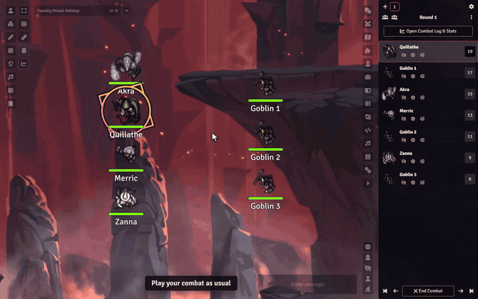

# Sephral’s Combat Log & Stats

**Who carried the fight? Who almost went down? Who kept the ogre on the ground for three rounds?** Combat Log & Stats records every fight while you play and turns it into numbers for you and a recap your players will love to read.

## Highlights

* **Records itself:** start a combat as usual and the log runs in the background, round by round. A reload does not stop it.
* **Every number that matters:** damage dealt and taken, healing, takedowns, times downed, critical hits, fumbles, control plays and damage per round for every combatant.
* **Credit where credit is due:** in D&D 5e every hit and every heal applied from a chat card goes to the combatant who rolled it, overkill included, also when Midi-QOL applies the damage. In other systems the module matches hit point changes to the rolls behind them.
* **Made for Crucible too:** health, wounds, morale and madness, heroes who end up Weakened, Broken or Dead, and every action card you confirm credited to the one who used it.
* **Impact Meter:** a sortable ranking of the fight. Who dealt the most damage, who kept the party alive, who locked down the enemies.
* **Charts at a glance:** damage per round for the party and the enemies, and damage dealt, taken and healed for every combatant.
* **Awards for the table:** MVP, Best Healer, Damage Sponge, Clutch Save, Lucky Dice and more, in the summary and in the player report.
* **Recaps for the whole table:** share a report in chat, as a journal entry or straight into Discord. Pick sections such as Hero Moments, Close Calls, Damage Spotlight or Tactical Turning Points and check the live preview before anyone else sees it.
* **Players can look too:** your players open the same window read only, with the sharing choices you made for each fight. One switch in the settings turns it off.
* **Your secrets stay secret:** hide enemy names, hidden combatants and enemy numbers. GM notes and private rolls never appear in a report.
* **You have the last word:** anything the log could not explain waits in the Corrections tab, and you can add or reduce damage and healing by hand.
* **Take your data with you:** export a fight as JSON, as a readable Markdown document or as a CSV table for your spreadsheet.

## How it works

1. Start a combat in the combat tracker. The log starts with it.
2. Play as always. Roll and apply damage and healing from the chat cards.
3. End the combat. The summary opens, and the Sharing tab turns it into a report for your players.

Open the window any time with the chart icon in the token controls or the button in the combat tracker.

## Install

Search for **Combat Log & Stats** in Foundry's module browser or open the [package page](https://foundryvtt.com/packages/sephrals-combat-log-stats).

Foundry VTT v13 and v14 · any game system, exact attribution in D&D 5e and Crucible · English and German

## Learn more

The [manual](MANUAL.md) explains exactly what is tracked, every setting, the report sections, the exports and where combat logs are stored, also on The Forge.

Questions or ideas? Join us on [Discord](https://discord.gg/7BjCgDYaBP). Looking for more? See [all modules by Sephral](https://github.com/Sephral).

## License

See [LICENSE.md](LICENSE.md).
