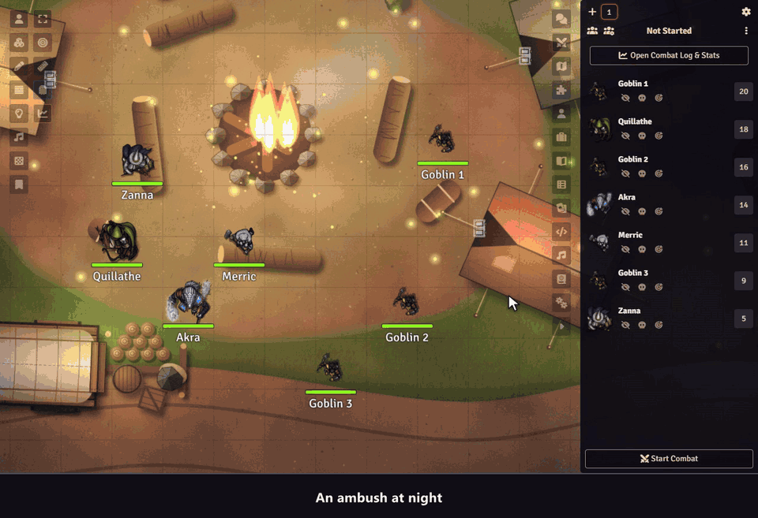

# Sephral’s Combat Log & Stats

**Who carried the fight? Who almost went down? Who kept the ogre on the ground for three rounds?** Combat Log & Stats records every fight while you play and turns it into numbers for you and a recap your players will love to read.

## Highlights

* **Records itself:** start a combat as usual and the log runs in the background, round by round. A reload does not stop it.
* **A summary when the fight ends:** a short card in the chat names the biggest hit and the closest call, tells the fight in one sentence per round and has a button to the full report. Whispered to you by default, and you can share it with the players as a summary or the full recap. One click copies the fight as a picture for Discord, saves it or posts it in the chat.
* **A danger bar for you:** during the fight the combat tracker shows the GM heroes against opponents by hit points at a glance.
* **A log outside combat too:** hit point and condition changes, deaths and rests between the fights, kept per game night so you see what happened since the last fight.
* **Every number that matters:** damage dealt and taken, healing, takedowns, times downed, critical hits, fumbles, control plays and damage per round for every combatant.
* **Credit where credit is due:** in D&D 5e every hit and heal goes to the combatant who rolled it, also with Midi-QOL. Other systems match hit point changes to the rolls behind them.
* **Made for Crucible too:** health, wounds, morale, madness and every confirmed action card credited to its user.
* **Impact Meter and awards:** a sortable ranking, damage per round for both sides, and awards such as MVP and Lucky Dice.
* **Game nights at a glance:** the Sessions tab adds up every fight of an evening or of the whole campaign. Post it to chat or copy it for Discord.
* **Recaps for the table:** share a report in chat, as a journal or in Discord, with a preview first.
* **Players can look too:** the same window, read only. Enemy names and numbers can stay hidden, GM notes never appear.
* **You have the last word:** correct or add damage and healing by hand, and export every fight as JSON, Markdown or CSV.

## How it works

1. Start a combat in the combat tracker. The log starts with it.
2. Play as always. Roll and apply damage and healing from the chat cards.
3. End the combat. A summary card appears in the chat, and the Sharing tab turns the fight into a report for your players.

Open the window any time with the chart icon in the token controls.

## Install

Search for **Combat Log & Stats** in Foundry's module browser or open the [package page](https://foundryvtt.com/packages/sephrals-combat-log-stats).

Foundry VTT 13 and 14 · any game system, exact attribution in D&D 5e, Pathfinder 2e and Crucible · English and German

## Learn more

The [manual](MANUAL.md) explains exactly what is tracked, every setting, the report sections, the exports and where combat logs are stored, also on The Forge.

Questions or ideas? Join us on [Discord](https://discord.gg/7BjCgDYaBP). Looking for more? See [all modules by Sephral](https://github.com/Sephral).

## License

See [LICENSE.md](LICENSE.md).
